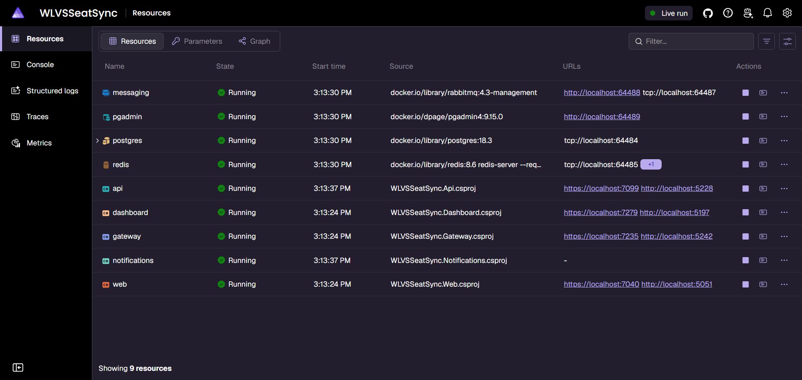

# SeatSync

Event ticketing platform built with .NET 10: live seat maps, QR tickets,
gate scanning, and AI-assisted event pages.

## Status
Phase 0 complete: solution structure and local orchestration with Aspire.

Phase 1 complete: domain model with tests, EF Core mapping and seed data.

Phase 2 complete: REST API with JWT auth, validation, ProblemDetails, and integration tests.

### Try it
Use this password for all below users `Passw0rd!`.

|Name|Username|Role|
|----|--------|--------|----|
|Ana Admin|admin@seatsync.dev|Admin|
|Oscar Organizer|organizer@seatsync.dev|Organizer|
|Sam Staff|staff@seatsync.dev|Staff|
|Andrea Attendee|attendee@seatsync.dev|Attendee|

## Run locally
Requirements: .NET 10 SDK, Docker Desktop.

    dotnet run --project src/SeatSync.AppHost